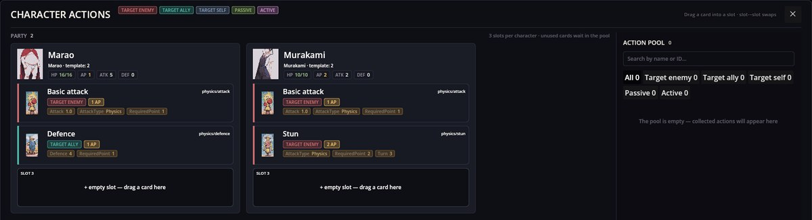
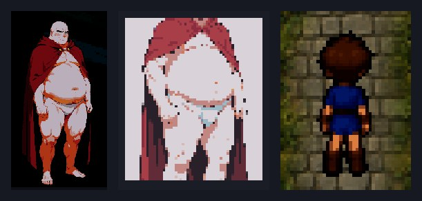

# Characters Engine — characters, their actions and the party

Characters Engine defines who takes part in battles: the hero, companions and enemies, with their health, attack, defence, action points and the action cards they can use. It also shows the **Character actions** panel, where you see your party and decide which cards each character takes into battle, and it supplies the portraits that appear next to dialog lines.

It is part of Cthangover and RPG Plus, and battle mods, recruiting and the editors build on it.

## The Character actions panel

Open it with the cards icon on the toolbar.



- **Party** — every character in your party with their portrait, health (HP), action points per turn (AP), attack (ATK) and defence (DEF).
- **Slots** — each character has three slots for action cards. A card shows its target (enemy, ally, self), its cost in AP and its values.
- **Action pool** — cards you own but have not assigned. Drag a card into a slot, or select a card and then a slot; dragging between slots swaps them. Search and filters narrow the pool.
- **Reset** puts the first three actions of each character's definition back into the slots; their other actions go to the pool.

## Three different pictures

A character can appear in three ways, and each comes from a different place:



1. **Dialog portrait (avatar)** — a picture in a mod's `avatars/` folder, chosen per line in a scenario: `text "…" first=marao/sad` fills the first portrait place, `second=…` the second (for a dialog between two people). It is not tied to a character definition.
2. **Character image** — the `Image` of the character definition, shown on cards in this panel and in battles.
3. **Map sprite (charset)** — the walking sprite on tile maps, chosen by the RPG mod (the game's **Appearance** setting or an event's `Sprite`), not by this mod.

## A character definition

Characters are JSON files of kind `character` in a mod's `characters/` folder. This is Marao from Cthangover — compare it with his card in the panel above:

```json
{
  "Kind": "character",
  "Items": [
    {
      "Id": "Marao",
      "Name": "characters/player/marao",
      "Image": "characters/player/marao",
      "Level": 1,
      "Point": 1,
      "Health": 16,
      "Defence": 0,
      "Attack": 5,
      "Actions": ["physics/attack", "physics/defence"]
    }
  ]
}
```

`Health 16` is his **HP 16/16**, `Point 1` his **AP 1**, `Attack 5` his **ATK 5**, and the two `Actions` are the **Basic attack** and **Defence** cards in his slots.

Other fields: `Behaviour` (the enemy's battle AI, such as `base`), `Exp` (experience given when beaten), `RecruitmentChance`, and `Loot` — a list of `ItemId`, `MinCount`, `MaxCount` and `Probability` dropped when the character is defeated.

## Action cards

Actions are JSON files of kind `action`. This mod ships the basic physical ones — **Basic attack**, **Defence** and **Stun**:

```json
{
  "Id": "physics/attack",
  "Name": "characters/action/physics_attack/name",
  "Description": "characters/action/physics_attack/description",
  "Image": "characters/actions/physics_attack",
  "Type": "ToEnemy",
  "Values": ["RequiredPoint=1", "Attack=1.0", "AttackType=Physics"]
}
```

`Type` sets the target (enemy, ally, self) or makes it passive or active; `RequiredPoint` is the AP cost. What the other values do in a fight is decided by the battle mod in use.

## Add a character to the party from a scenario

```scenario
action party.add id=rpg_hero
```

The character joins the party and the battle set. Someone already in the roster keeps their level and health. RPG Demo uses this line to give the player the hero when the village is first entered.

## If something goes wrong

1. **A character shows its id instead of a name.** The `Name` is a translation key; add it to the mod's `locale` files.
2. **No portrait next to a line.** The avatar name after `first=` / `second=` must match a picture in some mod's `avatars/` folder, for example `avatars/marao/sad.png` for `marao/sad`.
3. **A card cannot be used in battle.** The character has fewer AP than the card's `RequiredPoint`.
